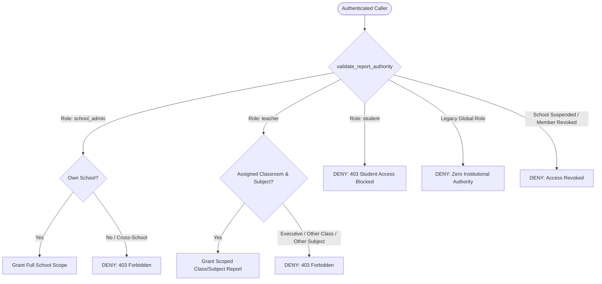
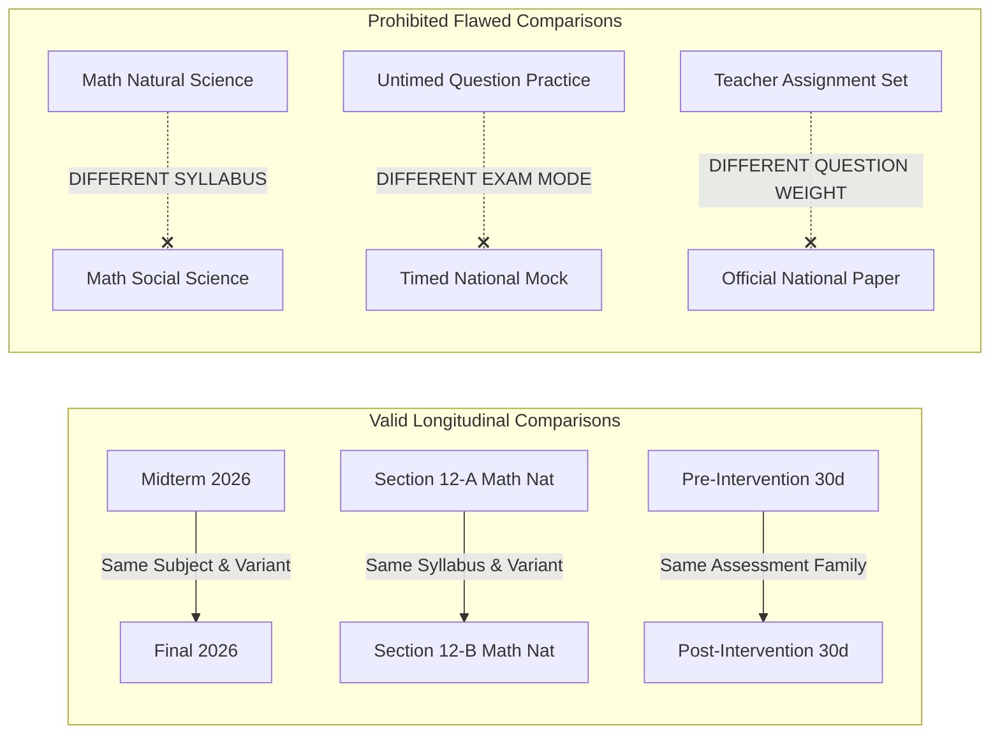

# FidelLearn P10: Institutional Analytics + Reporting Architecture Specification

## 1. Executive Summary & Vision

The **FidelLearn Institutional Analytics + Reporting Layer (P10)** converts the granular academic and operational evidence produced across **P5 (National Exam Simulation)**, **P6 (Multi-Tenant School Foundation)**, **P7 (Teacher Portal)**, **P8 (School Leadership Dashboard)**, and **P9 (Assignments + Intervention System)** into trustworthy, longitudinal institutional reports.

### The Central Analytical Question
P10 answers the primary governance and instructional leadership question:
> *"What changed over time, what action was taken, and what measurable evidence followed?"*

### The Core Analytical Principle: Non-Causal Honesty
In accordance with rigorous academic measurement standards, P10 enforces a strict distinction between **observed academic change following an intervention** and **causal attribution**:
- P10 **never** states that an intervention, assignment, or teacher *"caused"* or *"improved"* performance by $X\%$.
- Reports document the empirical timeline: baseline performance, action taken (intervention/assignment), and observed subsequent outcomes.
- Reports explicitly state when sample sizes are too small, when comparison evidence is non-comparable, when data freshness is degraded due to pending offline device syncs, or when data is missing.

---

## 2. Methodology & Version Specifications

### 2.1 Analytics Methodology Version: `institutional_analytics_v1`
Governs all mathematical, aggregation, and filtering algorithms across institutional reporting RPCs and presentation layers.
- **Deduplication**: For retakes of the same assessment within an evaluation window, the **latest completed attempt** is used for final summative scoring, while attempt counts preserve total volume.
- **Denominator Integrity**: All percentage metrics enforce strictly validated denominators. If the denominator is 0, the result is `NULL` (presented as "N/A" or "No data"), never `0.0%`.
- **Score Representation**: Percentage scores are rounded to 1 decimal place (`NUMERIC(5,1)`).
- **Time Window Alignment**: Evaluates events based on UTC completion timestamps (`completed_at`, `submitted_at`).

### 2.2 Report Schema Version: `institutional_report_schema_v1`
Governs the JSON contract, export schemas, and serialization formats for all 10 institutional report types:
1. `ExecutiveReport`: High-level institutional KPIs, stream trends, intervention coverage, and data quality overview.
2. `SubjectPerformanceReport`: Subject-specific mastery indicators, score distributions, and attempt volumes.
3. `StreamPerformanceReport`: Comparative performance between Natural Science and Social Science streams.
4. `ClassPerformanceReport`: Section-level performance for assigned teachers and school leaders.
5. `AssessmentReport`: Item and assessment-level breakdown (mean, median, 25th/75th percentiles, pass rates).
6. `AssignmentOutcomesReport`: Completion, timeliness, score distribution, and deadline integrity breakdowns.
7. `InterventionFollowUpReport`: Longitudinal tracking of student cohorts before and after documented interventions.
8. `StudentSupportReport`: School-wide support roster identifying students with active interventions and follow-up status.
9. `DataCoverageReport`: Freshness tiers, sync recency, and un-synced device estimation warnings.
10. `StudentAcademicReport`: Confidential individual longitudinal record for student, parent, or counselor review.

### 2.3 Intervention Follow-Up Methodology Version: `intervention_followup_v1`
Establishes standardized observational comparison windows around teacher interventions:
- **Baseline Window ($W_{\text{pre}}$)**: 30 days prior to intervention creation date. Evaluates completed attempts in the same subject/variant.
- **Follow-Up Window ($W_{\text{post}}$)**: 30 days following intervention creation date. Evaluates completed attempts in the same subject/variant.
- **Minimum Evidence Threshold**: Requires at least 1 completed assessment in $W_{\text{pre}}$ and at least 1 completed assessment in $W_{\text{post}}$.
- **Observed Change Classification**:
  - `higher`: Follow-up average score $>$ Baseline average score by $\ge +3.0\%$.
  - `lower`: Follow-up average score $<$ Baseline average score by $\le -3.0\%$.
  - `similar`: Follow-up average score within $\pm 3.0\%$ of baseline.
  - `insufficient_evidence`: Fewer than required attempts in either window.
- **Non-Causal Disclaimer**: Every report run includes the mandatory disclosure:
  > *"Observed score differences reflect subsequent empirical performance and do not demonstrate causal attribution to specific interventions or instructional strategies."*

---

## 3. Central Metric Dictionary

P10 defines 22 standard metrics in `InstitutionalMetricDictionary`. All SQL read models, Dart domain models, CSV exports, and document exports use these exact mathematical formulations:

| Metric Key | Display Name | Numerator | Denominator | Time Window | Min Evidence | Data Source |
| :--- | :--- | :--- | :--- | :--- | :--- | :--- |
| `active_students` | Active Students | Count of distinct students with $\ge 1$ attempt | Total enrolled students | Reporting window | 1 attempt | `attempts` |
| `total_attempts` | Total Attempts | Total count of completed attempts | N/A | Reporting window | 1 attempt | `attempts` |
| `mean_score` | Mean Score | Sum of percentage scores on latest attempts | Count of latest completed attempts | Reporting window | 1 attempt | `attempts` |
| `median_score` | Median Score | Middle value of sorted percentage scores | Count of latest completed attempts | Reporting window | 1 attempt | `attempts` |
| `p25_score` | 25th Percentile | Value below which 25% of scores fall | Count of latest completed attempts | Reporting window | 4 attempts | `attempts` |
| `p75_score` | 75th Percentile | Value below which 75% of scores fall | Count of latest completed attempts | Reporting window | 4 attempts | `attempts` |
| `pass_rate` | Pass Rate ($\ge 50\%$) | Count of latest attempts with score $\ge 50.0\%$ | Count of latest completed attempts | Reporting window | 1 attempt | `attempts` |
| `distinction_rate` | Distinction Rate ($\ge 75\%$) | Count of latest attempts with score $\ge 75.0\%$ | Count of latest completed attempts | Reporting window | 1 attempt | `attempts` |
| `stream_nat_mean` | Natural Science Mean | Sum of scores for Natural Science students | Count of Natural Science attempts | Reporting window | 1 attempt | `attempts` + `profiles` |
| `stream_soc_mean` | Social Science Mean | Sum of scores for Social Science students | Count of Social Science attempts | Reporting window | 1 attempt | `attempts` + `profiles` |
| `assignment_completion_rate` | Assignment Completion Rate | Count of recipients with status `completed` or `submitted` | Required recipients (`originalAssigned` + additions - excused) | Since publish | 1 recipient | `learning_assignment_recipients` |
| `assignment_on_time_rate` | Assignment On-Time Rate | Count of recipients submitted $\le$ due date | Count of submitted recipients | Since publish | 1 submission | `learning_assignment_recipients` |
| `assignment_late_rate` | Assignment Late Rate | Count of recipients submitted $>$ due date | Count of submitted recipients | Since publish | 1 submission | `learning_assignment_recipients` |
| `deadline_integrity_rate` | Verified Timing Rate | Count with verified server/monotonic time | Count of submitted recipients | Since publish | 1 submission | `learning_assignment_recipients` |
| `intervention_total` | Total Interventions | Total created interventions | N/A | Reporting window | 1 record | `student_interventions` |
| `intervention_completed_rate` | Intervention Action Execution Rate | Count of interventions with status `completed` | Total interventions | Reporting window | 1 record | `student_interventions` |
| `intervention_followup_rate` | Follow-Up Evidence Availability Rate | Interventions with $\ge 1$ post-intervention attempt | Total completed interventions | Follow-up window | 1 record | `student_interventions` + `attempts` |
| `observed_higher_rate` | Observed Subsequent Higher Rate | Interventions with post-score $>$ pre-score ($\ge +3\%$) | Interventions with comparable evidence | Follow-up window | 1 pair | `student_interventions` + `attempts` |
| `observed_similar_rate` | Observed Subsequent Similar Rate | Interventions with post-score within $\pm 3\%$ | Interventions with comparable evidence | Follow-up window | 1 pair | `student_interventions` + `attempts` |
| `observed_lower_rate` | Observed Subsequent Lower Rate | Interventions with post-score $<$ pre-score ($\le -3\%$) | Interventions with comparable evidence | Follow-up window | 1 pair | `student_interventions` + `attempts` |
| `fresh_data_rate` | High Freshness Rate | Count of active students synced $\le 24$ hours | Total active students | Current | 1 student | `profiles` |
| `stale_data_rate` | Stale Data Rate | Count of active students synced $> 7$ days | Total active students | Current | 1 student | `profiles` |

---

## 4. Multi-Tenant Authorization & Security Architecture

### 4.1 Role-Based Access Control (RBAC)
Institutional reporting is strictly governed by PostgreSQL Row Level Security (RLS) and verified within `SECURITY DEFINER` read-model functions using `validate_report_authority()`:



1. **School Admin**:
   - Authorized to generate and view all school-wide reports (`Executive`, `Subject`, `Stream`, `Class`, `Assessment`, `AssignmentOutcomes`, `InterventionFollowUp`, `StudentSupport`, `DataCoverage`).
   - Strictly bounded to their own active school (`p_school_id = active_school_id`).
   - Cross-school filter injection attempts raise an immediate SQL exception: `Access denied: Cross-school reporting prohibited`.
2. **Teacher**:
   - Authorized **only** for reports scoped to their explicitly assigned classrooms (`school_teachers` join `classroom_teachers`).
   - Blocked from school-wide `ExecutiveReport`, cross-classroom reports, and subjects they do not teach in that section.
   - Authorized for individual `StudentAcademicReport` **only** if the student is currently enrolled in their assigned classroom.
3. **Student**:
   - Zero access to institutional aggregation RPCs and `institutional_report_runs`. Calling any institutional reporting function raises `Access denied: Students cannot access institutional reports`.
   - Students access only their personal offline study history and inbox via P5/P9 client repositories.
4. **Platform Admin**:
   - Granted read-only operational audit access for system health; cannot impersonate institutional leadership without explicit school context.
5. **Legacy Global Roles & Revocation**:
   - Deprecated legacy roles (`admin`, `teacher`) in `user_roles` confer zero institutional authority. Only validated rows in `school_memberships` (with `is_active = true` and `schools.status = 'active'`) are honored.

### 4.2 SECURITY DEFINER Hardening
All 13 P10 reporting functions adhere to strict PostgreSQL security standards:
- Explicit `SET search_path = public, pg_temp;` to prevent search-path hijacking attacks.
- Caller identity derived strictly from `auth.uid()` via `validate_report_authority()`.
- Access granted strictly to `authenticated`; `PUBLIC` and `anon` execution is explicitly revoked.

---

## 5. Domain Invariants & Isolation Boundaries

### 5.1 Mathematics Variant Isolation
Mathematics Natural Science and Mathematics Social Science curricula in Ethiopia share subject prefixes but represent distinct syllabi, pacing, and national examination booklets:
- Subject ID: `math_g12`.
- Variants: `naturalScience` vs. `socialScience`.
- **Invariant**: P10 reports isolate Math variants completely. Queries match exact `exam_variant`. Records with missing, mismatched, or conflicting variants are excluded from variant aggregates to prevent cross-stream contamination.

### 5.2 National Exam Simulation (P5) Provenance
Reports differentiating formal exam readiness must preserve P5 provenance:
- Exam attempts record `source_type` (`officialPastExam`, `modelExam`, `customPractice`, `generatedSimulation`), `exam_mode` (`timedSimulation`, `untimedPractice`), and `exam_type` (`nationalSimulation`, `teacherAssigned`).
- Standard mock exam benchmarks evaluate **only** attempts with `exam_mode = 'timedSimulation'` and `source_type IN ('officialPastExam', 'modelExam', 'generatedSimulation')`.
- Informal untimed practice attempts are segregated to prevent inflating mock exam percentiles.

### 5.3 Device-Local Mastery (P4) and National Readiness Preservation
- **P4 Mastery (`fidel_spaced_v1.0`)**: Spaced repetition memory states ($S, R, D$) and item stability remain strictly device-local Drift SQLite data. P10 cloud reports **never** synthesize fake institutional mastery growth curves.
- **National Exam Composite Readiness**: Composite readiness prediction is calculated client-side from local calibration. Institutional reports display empirical mean exam scores and distributions, never claiming simulated readiness as verified institutional truth.

### 5.4 Assignment Denominators & Timeliness
Reuses frozen P9 Assignment invariants:
- **Eligible Denominator**: `requiredForCompletion = originalAssigned + postPublishAdditions - excused`.
- **Timeliness Segregation**: Submissions are partitioned into:
  - `verifiedOnTime`: Device completed $\le$ due date with untampered monotonic clock.
  - `verifiedLate`: Device completed $>$ due date.
  - `unverifiedTiming`: Monotonic clock jump or backward drift detected offline; submission recorded as unverified.
  - `clockAnomaly`: Clock tampering detected; excluded from on-time percentages.

---

## 6. Longitudinal Methodology & Comparability

### 6.1 Academic Time Windows
P10 supports flexible time filtering:
- Preset periods: `last7Days`, `last30Days`, `last90Days`, `currentSemester`, `fullAcademicYear`.
- Custom windows: Explicit `p_window_start` and `p_window_end` TIMESTAMPTZ parameters.
- **No Inferred Terms**: Schools operate on distinct regional and academic calendars. P10 never guesses school terms; dates must be explicitly supplied or derived from active school year boundaries.

### 6.2 Retake Deduplication Policy
Students frequently retake practice exams and assignments:
- When computing student performance distributions, pass rates, and subject means, P10 applies a deterministic **latest-completed deduplication window** using PostgreSQL `DISTINCT ON (student_user_id, subject_id, exam_id) ORDER BY student_user_id, subject_id, exam_id, completed_at DESC`.
- This prevents highly active students from skewing section means through repeated attempts of the same test.
- Raw attempt counts (`total_attempts`) preserve total system engagement volume.

### 6.3 Comparability Rules
To prevent misleading longitudinal claims, comparisons must adhere to the following matrix:



---

## 7. Privacy & Small-Group Protection

### 7.1 Aggregate Suppression ($k$-Anonymity)
To protect student privacy in small classes, electives, or low-enrollment streams:
- **Threshold**: $\text{Minimum Sample Size } (k) = 5$.
- If the number of distinct students in an aggregation bucket (class, stream, subject) is $< 5$:
  - Mean score, median, standard deviation, pass rate, and score distributions are **suppressed** (`mean_score = NULL`, `is_suppressed = true`).
  - The report displays: `"Data suppressed to protect student privacy (fewer than 5 students in sample)"`.
  - Student counts are displayed, but scores are obscured.

### 7.2 PII Redaction in Exports
- **CSV Exports**:
  - Class and school-level CSVs include student IDs, screen names, and aggregated metrics.
  - Personal contact info (phone numbers, parent details, passwords) is strictly excluded.
  - Formula injection mitigation: Cell values starting with `=`, `+`, `-`, or `@` are sanitized with a leading single quote `'` in RFC 4180 output.
- **Teacher Boundaries**:
  - Teachers exporting gradebook outcomes can view only students enrolled in their assigned sections.
  - No teacher can export another teacher's class or view school-wide student lists.

### 7.3 No Teacher Performance Ranking
P10 strictly prohibits teacher evaluation scores, "Top Teacher" leaderboards, or cross-teacher performance league tables. Teacher coverage reports display operational assignment and intervention volume, never comparative student score averages.

---

## 8. Report-Run Lifecycle & Artifact Management

### 8.1 Schema: `public.institutional_report_runs`
All generated reports are tracked in an immutable audit ledger:

```sql
CREATE TABLE public.institutional_report_runs (
    id UUID PRIMARY KEY DEFAULT gen_random_uuid(),
    school_id UUID NOT NULL REFERENCES public.schools(id) ON DELETE CASCADE,
    created_by_user_id UUID NOT NULL REFERENCES public.profiles(id),
    report_type TEXT NOT NULL,
    report_title TEXT NOT NULL,
    scope_type TEXT NOT NULL,  -- 'school', 'classroom', 'subject', 'stream', 'student'
    scope_id TEXT NULL,
    parameters JSONB NOT NULL DEFAULT '{}'::jsonb,
    analytics_version TEXT NOT NULL DEFAULT 'institutional_analytics_v1',
    schema_version TEXT NOT NULL DEFAULT 'institutional_report_schema_v1',
    status TEXT NOT NULL DEFAULT 'pending', -- 'pending', 'generating', 'completed', 'failed'
    storage_path TEXT NULL,
    file_format TEXT NULL,    -- 'json', 'csv', 'pdf'
    file_size_bytes BIGINT NULL,
    sha256_hash TEXT NULL,
    error_message TEXT NULL,
    data_as_of TIMESTAMPTZ NOT NULL DEFAULT NOW(),
    created_at TIMESTAMPTZ NOT NULL DEFAULT NOW(),
    completed_at TIMESTAMPTZ NULL
);
```

### 8.2 Private Storage & Access Control
- **Storage Bucket**: `institutional-reports` (Private, Supabase Storage).
- **Access Rule**: Direct public URLs are prohibited. Downloads require a short-lived **signed URL** (maximum 15 minutes TTL) generated via backend RPC after verifying tenant and role authorization.
- **Integrity Verification**: Every export file generates a SHA-256 content hash upon generation, stored in `sha256_hash`. Download clients verify this checksum to ensure artifact tamper-evidence.
- **Retention**: Report run records and export files are retained for 3 years to comply with academic record-keeping standards, after which automated lifecycle policies transition artifacts to cold storage.

---

## 9. Data Freshness & Offline Sync Awareness

### 9.1 Freshness Tiers
Because FidelLearn operates offline-first, institutional cloud data reflects only sessions that have synchronized:
- `fresh`: Student device synced $\le 24$ hours ago.
- `moderate`: Student device synced between 24 hours and 7 days ago.
- `stale`: Student device synced between 7 days and 30 days ago.
- `very_stale`: Student device synced $> 30$ days ago.
- `unknown`: No sync record available.

### 9.2 Institutional Data Disclosure
Every P10 report incorporates a Data Freshness indicator:
> *"Notice: FidelLearn is an offline-first learning system. A student who has not synchronized recently may have completed extensive study offline. Current reports reflect synchronized cloud records as of the timestamp indicated."*

---

## 10. Performance & Scalability

### 10.1 Database Indexing
The migration provisions targeted composite B-tree indexes to ensure sub-100ms reporting query execution over institutional datasets:
- `idx_attempts_school_completed`: `(school_id, completed_at DESC, subject_id)`
- `idx_attempts_student_subject`: `(student_user_id, subject_id, completed_at DESC)`
- `idx_assignment_recipients_status`: `(assignment_id, status)`
- `idx_interventions_school_subject`: `(school_id, subject_id, created_at DESC)`
- `idx_report_runs_school`: `(school_id, created_at DESC)`

### 10.2 Client-Side Rendering & Caching
- **Riverpod Family Providers**: Family parameters cache window bounds (`DateTime` rounded to minute precision) to avoid re-triggering network fetches during widget rebuilds.
- **Streaming Exports**: CSV generation runs in a pure Dart isolate/stream pipeline preventing UI thread jank even on large rosters.

---

## 11. Drift SQLite Storage
In accordance with P10 specifications, **Drift SQLite remains at schema version 9**. Institutional analytics and reporting are cloud read models and do not mutate local student schema. Local testing and offline preview are supported through the in-memory `LocalInstitutionalReportingRepository`.
