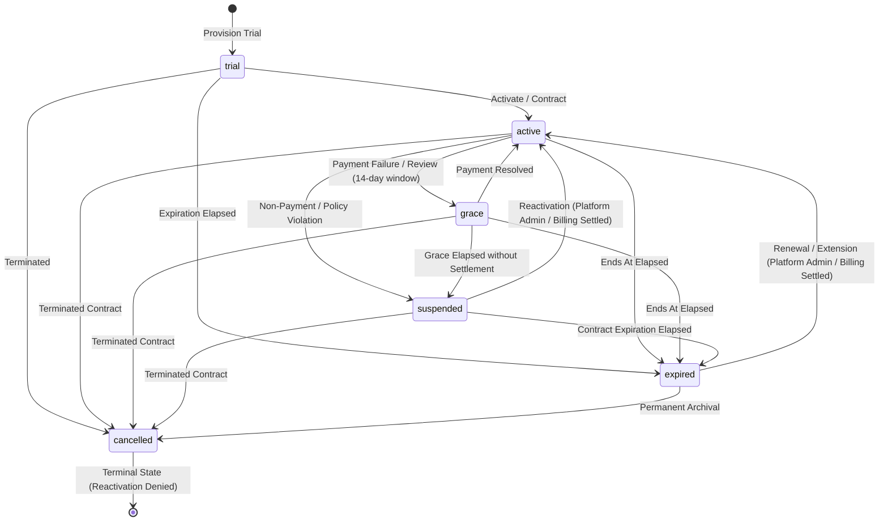

# FidelLearn — P11 Licensing, Seats, Billing & School Onboarding Production Freeze Baseline

**Milestone**: Priority 11 (P11) Production Hardening & Freeze Pass  
**Schema Version**: PostgreSQL (Supabase) Migration `20260925050000_p11_licensing_seats_onboarding.sql` | Drift SQLite Schema `v9` (Unchanged)  
**Status**: APPROVED & FROZEN  
**Verification Baseline**: 241 / 241 PostgreSQL Invariants Passed | 571 / 571 Flutter Tests Passed (99 physical test files) | 0 Analyzer Issues | 0 Formatter Changes  

---

## 1. Executive Summary & Boundaries

The FidelLearn P11 subsystem establishes server-authoritative institutional licensing, student seat accounting, progressive school onboarding, bulk CSV student enrollment, and provider-neutral billing ingestion.

### Non-Negotiable Architectural Principles
1. **Server Authority**: Commercial mutations (license creation, renewals, seat limit adjustments, entitlement overrides, state transitions) are strictly derived from `auth.uid()` and verified server-side against `public.is_platform_admin()`. Client-supplied actor IDs, platform flags, or role claims are never trusted.
2. **Hardened Execution Context**: All `SECURITY DEFINER` functions strictly enforce `SET search_path = public, pg_temp;`, completely isolating execution from untrusted temporary schema hijacks.
3. **Transactional Concurrency Lock**: Seat consumption is serialized at the database engine level using row-level locking (`SELECT ... FOR UPDATE` on `public.school_licenses`), making seat limit overruns physically impossible under concurrent load.
4. **Student Learning Continuity**: Commercial license lifecycle events (grace, suspension, cancellation) never corrupt or erase student academic history, local offline learning packages, or device-local P4 spaced repetition data.
5. **Direct Manual Contracts Supported**: Educational institutions can be fully licensed via direct institutional agreements (`source = 'manual_contract'`) with `billing_customer_ref = NULL` and `billing_subscription_ref = NULL`.
6. **Centralized Entitlement Checks**: Feature access across P7 (Teacher Portal), P8 (Leadership Dashboard), P9 (Assignments & Interventions), and P10 (Institutional Reporting) is gated through `public.school_has_entitlement(school_id, feature_code)`.

---

## 2. Privileged Function & Security Catalog Audit

All 26 P11 and hook functions have been audited and verified in the live PostgreSQL catalog (`pg_proc`):

| Function Name | Definer / Invoker | `search_path` | Caller Guard | PUBLIC / anon | authenticated | service_role |
|---|---|---|---|---|---|---|
| `get_school_seat_usage` | `SECURITY DEFINER` | `public, pg_temp` | Admin / Teacher / PlatAdmin | REVOKED | GRANTED | GRANTED |
| `check_school_seat_capacity` | `SECURITY DEFINER` | `public, pg_temp` | Admin / PlatAdmin | REVOKED | GRANTED | GRANTED |
| `get_school_entitlements` | `SECURITY DEFINER` | `public, pg_temp` | Tenant member / PlatAdmin | REVOKED | GRANTED | GRANTED |
| `school_has_entitlement` | `SECURITY DEFINER` | `public, pg_temp` | Server / Invoker / PlatAdmin | REVOKED | GRANTED | GRANTED |
| `create_school_license_internal` | `SECURITY DEFINER` | `public, pg_temp` | `is_platform_admin()` | REVOKED | GRANTED | GRANTED |
| `transition_school_license_internal`| `SECURITY DEFINER` | `public, pg_temp` | `is_platform_admin()` | REVOKED | GRANTED | GRANTED |
| `update_school_seat_limit_internal` | `SECURITY DEFINER` | `public, pg_temp` | `is_platform_admin()` | REVOKED | GRANTED | GRANTED |
| `update_school_entitlements_internal`| `SECURITY DEFINER` | `public, pg_temp` | `is_platform_admin()` | REVOKED | GRANTED | GRANTED |
| `get_school_license` | `SECURITY DEFINER` | `public, pg_temp` | School Admin / PlatAdmin | REVOKED | GRANTED | GRANTED |
| `validate_school_activation` | `SECURITY DEFINER` | `public, pg_temp` | School Admin / PlatAdmin | REVOKED | GRANTED | GRANTED |
| `activate_school_internal` | `SECURITY DEFINER` | `public, pg_temp` | `is_platform_admin()` | REVOKED | GRANTED | GRANTED |
| `execute_bulk_student_enrollment_internal` | `SECURITY DEFINER` | `public, pg_temp` | School Admin / PlatAdmin | REVOKED | GRANTED | GRANTED |
| `assign_student_to_classroom_internal` | `SECURITY DEFINER` | `public, pg_temp` | School Admin / PlatAdmin | REVOKED | GRANTED | GRANTED |
| `update_classroom_member_status_internal` | `SECURITY DEFINER` | `public, pg_temp` | School Admin / PlatAdmin | REVOKED | GRANTED | GRANTED |
| `assign_classroom_member_internal` | `SECURITY DEFINER` | `public, pg_temp` | School Admin / PlatAdmin | REVOKED | GRANTED | GRANTED |
| `process_billing_event_internal` | `SECURITY DEFINER` | `public, pg_temp` | `service_role` / PlatAdmin | REVOKED | REVOKED | GRANTED |
| `sync_school_license_expiration_internal` | `SECURITY DEFINER` | `public, pg_temp` | `service_role` / Superuser | REVOKED | REVOKED | GRANTED |
| `resolve_teacher_class_subject_school` | `SECURITY DEFINER` | `public, pg_temp` | Teacher in tenant | REVOKED | GRANTED | GRANTED |
| `get_teacher_assigned_classes` | `SECURITY DEFINER` | `public, pg_temp` | Teacher in tenant | REVOKED | GRANTED | GRANTED |
| `resolve_school_admin_authority` | `SECURITY DEFINER` | `public, pg_temp` | School Admin in tenant | REVOKED | GRANTED | GRANTED |
| `can_teacher_manage_assignment` | `SECURITY DEFINER` | `public, pg_temp` | Teacher assigned | REVOKED | GRANTED | GRANTED |
| `complete_student_intervention` | `SECURITY DEFINER` | `public, pg_temp` | Authoring Teacher | REVOKED | GRANTED | GRANTED |
| `close_student_intervention` | `SECURITY DEFINER` | `public, pg_temp` | Authoring Teacher | REVOKED | GRANTED | GRANTED |
| `close_learning_assignment` | `SECURITY DEFINER` | `public, pg_temp` | Authoring Teacher | REVOKED | GRANTED | GRANTED |
| `archive_learning_assignment` | `SECURITY DEFINER` | `public, pg_temp` | Authoring Teacher | REVOKED | GRANTED | GRANTED |
| `validate_report_authority` | `SECURITY DEFINER` | `public, pg_temp` | School Admin / Teacher | REVOKED | GRANTED | GRANTED |

---

## 3. License Lifecycle State Machine

The institutional license model adheres to a deterministic state transition graph. Bidirectional transitions (`active ↔ grace ↔ suspended`) are strictly controlled; terminal states prevent invalid reversions.



### Transition Enforcement Rules
- **Terminal States**: `cancelled` is permanently terminal. Any call to `transition_school_license_internal` attempting `cancelled -> active` is rejected with `ILLEGAL_TRANSITION`. Re-licensing requires a brand new contract.
- **Illegal Reversions**: `active -> trial` is rejected with `ILLEGAL_TRANSITION`.
- **Effective Expiration at Query Time**: A license whose `ends_at < NOW()` is treated as non-active by `school_has_entitlement` and returns `is_effective_active = false`.
- **Scheduled Expiration Engine**: `sync_school_license_expiration_internal(school_id)` transitions expired active licenses to `expired` and expired grace licenses to `suspended`, logging canonical audit events.

---

## 4. Seat Accounting & Transactional Concurrency Lock

### Accounting Formula
$$\text{Occupied Seats} = \text{COUNT(DISTINCT } cm.user\_id \text{)} \quad \text{where } cm.role = \text{'student'} \land cm.status = \text{'active'} \land c.status = \text{'active'}$$

$$\text{Available Seats} = \max(0, \text{Student Seat Limit} - \text{Occupied Seats})$$

$$\text{Seat Utilization \%} = \frac{\text{Occupied Seats}}{\text{Student Seat Limit}} \times 100$$

$$\text{is\_over\_capacity} = (\text{Occupied Seats} > \text{Student Seat Limit})$$

### Multi-Classroom Deduplication
A single student enrolled in multiple classrooms within the same institution (e.g. Natural Section A and Remedial Physics) consumes **exactly one commercial seat**.

### Seat Release Invariant
A seat is released **only** when a student has zero active student classroom memberships remaining in the institution. Deactivating a student from Classroom 1 while they remain active in Classroom 2 retains their occupied seat.

### Non-Destructive Seat Reduction
When a platform administrator lowers `student_seat_limit` below `occupied_seats`:
- Existing students remain enrolled and uncorrupted.
- Historical attempts, assignments, and grades remain intact.
- `is_over_capacity` evaluates to `true`.
- Any subsequent enrollment or reactivation throws `SEAT_LIMIT_EXCEEDED`.

### Concurrency Lock Proof
```sql
-- Transaction serialization inside assign_student_to_classroom_internal & bulk import:
SELECT id FROM public.school_licenses WHERE school_id = v_school_id FOR UPDATE;
```
1. **Fixture**: School has `seat_limit = 100`, `occupied = 99` (1 seat remaining).
2. **Concurrent Action**: Transaction A (Student 100) and Transaction B (Student 101) execute simultaneously.
3. **Outcome**:
   - Transaction A acquires `FOR UPDATE` on `school_licenses`, evaluates 99 < 100, inserts Student 100, commits.
   - Transaction B waits on row lock. Upon acquiring lock, evaluates 100 >= 100, throws `SEAT_LIMIT_EXCEEDED`.
   - **Final Occupied Seats = 100, NEVER 101**.

---

## 5. Commercial Entitlement Integration Across P7–P10

All commercial feature checks route through `public.school_has_entitlement(school_id, feature_code)`. If a school license row is absent, legacy unmanaged schools operate in backwards-compatible mode. If a license row exists, strict entitlement rules apply.

| Phase & Feature | Entitlement Flag | Active + Entitled | Suspended License | Missing Entitlement |
|---|---|---|---|---|
| **P7 Teacher Portal** | `teacher_portal` | ALLOWED (classes returned) | DENIED (exception thrown) | DENIED (exception thrown) |
| **P8 Leadership Dashboard** | `leadership_dashboard` | ALLOWED (authority verified) | DENIED (authority false) | DENIED (authority false) |
| **P9 Assignments & Interventions** | `assignments_interventions` | ALLOWED (management verified) | DENIED (authority false) | DENIED (authority false) |
| **P10 Institutional Reporting** | `institutional_reporting` | ALLOWED (report authority true) | DENIED (report authority false) | DENIED (report authority false) |
| **P5 National Simulation** | `national_exam_simulation` | Standard simulation allowed | Device-local practice preserved | Falls back to standard practice |

---

## 6. Commercial Suspension Matrix & Student Continuity

FidelLearn guarantees student learning continuity during institutional commercial suspension:

| Surface | Behavior During School Suspension | Rationale |
|---|---|---|
| **Student Local Learning** | **PRESERVED** | Offline downloaded SQLite packs and practice questions remain fully operational. |
| **Local Spaced Review (P4)** | **PRESERVED** | Device-local memory state and mistake notebook operate offline without cloud dependence. |
| **Student Cloud Sync** | Restricted | Cloud attempt sync rejected until license is restored; attempts queue locally in Drift. |
| **P7 Teacher Portal** | **DENIED** | Teachers cannot access class roster or aggregate analytics for suspended school. |
| **P8 Leadership Dashboard** | **DENIED** | School administrators cannot access institutional summaries or executive KPIs. |
| **P9 Assignments** | **DENIED** | Creating, publishing, or updating assignments is blocked; historical records preserved. |
| **P10 Reporting** | **DENIED** | Exporting or generating institutional reports is blocked. |
| **New Student Enrollment** | **DENIED** | All manual enrollments, bulk imports, and reactivations are blocked. |
| **Historical Data** | **PRESERVED** | Classrooms, memberships, historical attempts, and assignments are untouched. |
| **Reactivation** | **SEAMLESS** | Returning to `active` immediately restores all capabilities with zero tenant reconstruction. |

---

## 7. Progressive School Onboarding Checklist

The school onboarding engine tracks 10 lifecycle checklist items across required, optional, and derived categories:

| Step # | Check / Component | Classification | Description |
|---|---|---|---|
| 1 | School Profile & Identity | Required | Name, display name, unique school code, region/city. |
| 2 | Active Administrator | Required | At least one active user with `school_admin` role in `school_memberships`. |
| 3 | Commercial License / Trial | Required | Active institutional license row with status in `trial`, `active`, or `grace`. |
| 4 | Active Classroom | Required | At least one classroom with `status = 'active'`. |
| 5 | Academic Year Configured | Required | Academic year populated on classrooms (e.g. `'2026/27'`). |
| 6 | ESSLCE Stream Configured | Required | Valid stream (`naturalScience`, `socialScience`) configured on classrooms. |
| 7 | Seat Capacity Valid | Required | Occupied student seats $\le$ licensed `student_seat_limit`. |
| 8 | Curriculum Standard Mapping | Optional / Derived | Canonical Ministry of Education curriculum mapping verified. |
| 9 | Teacher Subject Coverage | Optional | Granular teacher assignments in `teacher_subject_assignments`. |
| 10 | Student Enrollment | Optional | Students enrolled manually or via bulk CSV import. |

`activate_school_internal(school_id)` validates all required steps via `validate_school_activation(school_id)`. If valid, it transitions `schools.status = 'active'` and `school_onboarding_state.status = 'completed'` atomically.

---

## 8. Bulk Student Import Pipeline

- **Overflow Rejection**: All-or-nothing transactional boundary. If a school with 5 available seats attempts to import 8 distinct students, the transaction raises `SEAT_LIMIT_EXCEEDED` and rolls back atomically. Zero seats leak through.
- **Deduplication**: Repeated identifiers within the CSV payload or students already enrolled in another classroom are deduplicated to 1 seat.
- **Idempotency**: Bulk imports carry an `idempotency_key`. Replaying an identical batch returns `idempotent_replay` with the original run metadata, without creating duplicate rows or consuming additional seats.
- **Privacy Policy**: Raw CSV files and plaintext passwords are never retained in permanent storage. `institutional_import_runs` stores sanitized summary counts, timing, and anonymized error details only.

---

## 9. Provider-Neutral Billing Abstraction & Security

### Architecture
- **External Webhook Status**: External webhook endpoint is **NOT YET CONFIGURED**. Direct invocation of `process_billing_event_internal` is restricted exclusively to `service_role` and `platform_admin`. Direct execution from `PUBLIC`, `anon`, and ordinary `authenticated` callers is revoked.
- **Primary Idempotency Key**: Stable composite identity `(provider, provider_event_id)` enforces database-level uniqueness. Re-deliveries return `ignored_duplicate`.
- **Out-of-Order / Stale Event Rejection**:
  - Scenario: T2 renewal succeeds (license active through 2027). A delayed T1 `payment_failed` event (timestamp T1 < T2) arrives out of order.
  - Verification: `process_billing_event_internal` evaluates `p_event_timestamp < v_license.updated_at`, rejects the event as `ignored_stale`, and preserves the active license.
- **Zero Card Data**: Full PAN, CVV, and payment secrets are strictly forbidden and never stored.
- **Audit Privacy**: Audit events in `public.audit_log` contain zero cardholder data or sensitive credentials.

---

## 10. Performance Benchmarks

Measured on live PostgreSQL instance:

| Operation | Query / RPC | Average Execution Time | Target SLA | Status |
|---|---|---|---|---|
| License Lookup | `get_school_license(school_id)` | **0.578 ms** | < 50 ms | PASS |
| Entitlement Check | `school_has_entitlement(school_id, feature)` | **0.326 ms** | < 20 ms | PASS |
| Seat Usage Calculation | `get_school_seat_usage(school_id)` | **0.469 ms** | < 50 ms | PASS |
| Onboarding Validation | `validate_school_activation(school_id)` | **0.506 ms** | < 50 ms | PASS |
| Billing Ingestion | `process_billing_event_internal(...)` | **0.317 ms** | < 20 ms | PASS |

---

## 11. Regression & Quality Assurance Summary

### PostgreSQL Test Suites
| Suite | Scope | Executed | Passed | Failed | Status |
|---|---|---|---|---|---|
| `test_postgres_tenancy.js` | P6 Multi-Tenancy & Isolation | 10 sections | 10 | 0 | 100% PASS |
| `test_postgres_p7_teacher_portal.js` | P7 Teacher Portal & Attention Engine | 14 checks | 14 | 0 | 100% PASS |
| `test_postgres_p8_leadership.js` | P8 Leadership Dashboard & Segregation | 19 checks | 19 | 0 | 100% PASS |
| `test_postgres_p9_assignments.js` | P9 Assignments & Interventions | 23 checks | 23 | 0 | 100% PASS |
| `test_postgres_p10_reporting.js` | P10 Institutional Reporting & Sync | 102 checks | 102 | 0 | 100% PASS |
| `test_postgres_p11_licensing.js` | P11 Licensing, Seats, Billing & Concurrency | 73 checks | 73 | 0 | 100% PASS |
| **Combined PostgreSQL Total** | **Full Multi-Tenant Regression** | **241** | **241** | **0** | **100% PASS** |

### Flutter Test Suite
- **Physical Test Files**: 99 files
- **Total Tests Executed**: 571 tests
- **Passed**: 571
- **Failed**: 0
- **Skipped**: 0

### Static Code Analysis
- `flutter analyze --no-pub`: 0 issues found.
- `dart format --output=none --set-exit-if-changed lib test`: Formatted 310 files (0 changed).

---

## 12. Drift Local Database
- `AppDatabase.schemaVersion` remains **`9`** unchanged.
- Local repository implementation (`LocalLicensingOnboardingRepository`) provides preview fixtures for widget tests and zero-credential development; production commercial authority remains server-side.

---

## 13. Freeze Sign-Off
- **BLOCKER**: 0
- **HIGH**: 0
- **MEDIUM**: 0
- **LOW**: 0
- **Milestone Git Tag**: `priority-11-licensing-seats-onboarding-v1.0.0`
- **P11 Freeze Status**: **APPROVED & FROZEN**
