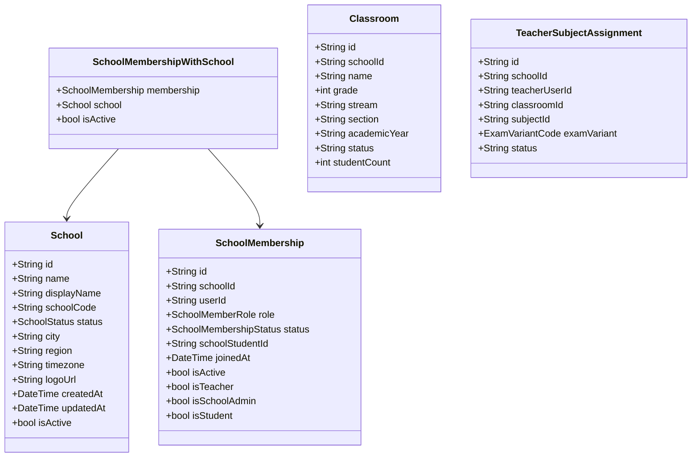
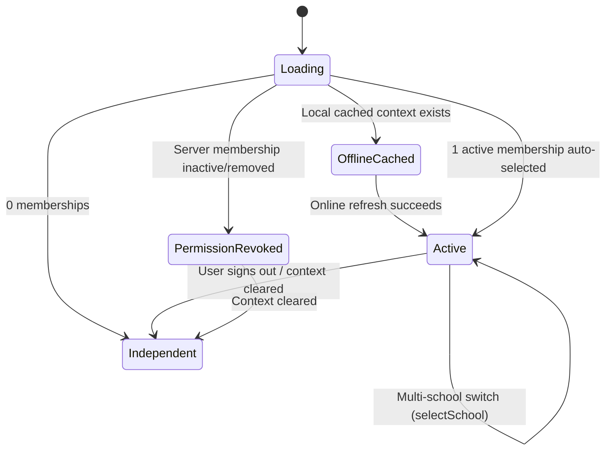

# FidelLearn — P6 Stage 2 Institutional Client Architecture Specification

**Status**: IMPLEMENTED & VERIFIED  
**Date**: September 25, 2026  
**Parent Foundation**: P6 Stage 1 Multi-Tenant Database, RLS & Security Foundation (`FROZEN`)  
**Drift SQLite Schema**: Version 8 (unchanged)  
**Test Suite**: 460 automated tests passing, 0 analyzer issues  

---

## 1. Executive Summary & Purpose

P6 Stage 1 established a multi-tenant backend architecture verified directly against real PostgreSQL/Supabase, enforcing row-level security, tenant-scoped roles, and trusted RPC mutations.

**P6 Stage 2** connects FidelLearn's Flutter application layer to that secure backend. It:
1. Replaces synthetic institutional mock data with pure-Dart canonical domain models.
2. Implements real `SupabaseSchoolRepository` and `SupabaseClassroomRepository` communicating via the authenticated client session and PostgreSQL RLS.
3. Introduces `ActiveSchoolContext` as an application display state machine that coordinates multi-school selection, student transfer, membership deactivation, and offline affiliation display without compromising security.
4. Adheres strictly to the foundational architectural rule:
   > **ActiveSchoolContext is a UI and display context only—it is NOT backend authorization.**  
   > PostgreSQL Row Level Security (RLS) remains the sole authoritative gatekeeper for institutional tenant data.

---

## 2. Pure-Dart Domain Layer

All domain models reside in `lib/features/school/domain/models/tenant_models.dart`. They are **pure Dart entities** with zero dependencies on Flutter, Supabase, Drift, or PostgREST.

### 2.1 Canonical Models & Enums

1. **`School`**:
   - Status: `SchoolStatus.active`, `SchoolStatus.suspended`, `SchoolStatus.archived`, `SchoolStatus.unknown`.
   - Forward compatibility: Unrecognized future backend status values parse safely to `SchoolStatus.unknown` without crashing the application or silently granting active status.
2. **`SchoolMembership`**:
   - Role: `SchoolMemberRole.student`, `SchoolMemberRole.teacher`, `SchoolMemberRole.schoolAdmin`, `SchoolMemberRole.unknown`.
   - Status: `SchoolMembershipStatus.invited`, `SchoolMembershipStatus.active`, `SchoolMembershipStatus.inactive`, `SchoolMembershipStatus.removed`, `SchoolMembershipStatus.unknown`.
3. **`Classroom`**:
   - **Architectural Update**: The old mock assumption `classroom.teacherId` is removed. Teacher authority is now derived from `TeacherSubjectAssignment`.
   - Stream Normalization: Reuses canonical Grade 12 stream semantics (`naturalScience`, `socialScience`), safely normalizing legacy raw values (`natural` $\to$ `naturalScience`, `social` $\to$ `socialScience`).
4. **`TeacherSubjectAssignment`**:
   - Reuses frozen `ExamVariantCode` (`shared`, `naturalScience`, `socialScience`) from `subject_models.dart`, preventing redundant variant enums.
5. **`SchoolInvitation`**:
   - Plaintext invitation tokens and cryptographic hashes (`token_hash`) are **strictly excluded** from client domain models. Invitation secrets belong exclusively to server-side redemption workflows.

---

## 3. Data Layer & Supabase Repositories

### 3.1 DTOs and Error Mapping (`lib/features/school/data/models/school_dtos.dart`)
- PostgREST responses are mapped via separate DTOs: `SchoolDto`, `SchoolMembershipDto`, `ClassroomDto`, `ClassroomMembershipDto`, `TeacherSubjectAssignmentDto`.
- `mapSupabaseError(error)` translates backend exceptions into typed domain failures:
  - PostgreSQL `42501` / `insufficient_privilege` / RLS denial $\longrightarrow$ `PermissionDeniedFailure`
  - `SocketException` / `TimeoutException` $\longrightarrow$ `NetworkFailure`
  - `PGRST116` / Not Found $\longrightarrow$ `NotFoundFailure`
  - Membership status checks $\longrightarrow$ `MembershipInactiveFailure`

### 3.2 `SupabaseSchoolRepository`
- **Authenticated Session Only**: Operates strictly via `Supabase.instance.client` with user JWT. Never embeds or uses `service_role`.
- **Relational Read**: `getMySchools()` uses PostgREST foreign key selection `select('*, schools(*)')` to fetch all user memberships and parent school records in a single network round-trip.
- **Honors IDs**: Explicitly uses passed `schoolId` parameters (fixing the legacy mock bug where school ID was ignored).
- **No Silent Fallbacks**: If Supabase is unavailable or returns an error, the repository throws honest typed failures rather than silently substituting Bole Mock data.

### 3.3 `SupabaseClassroomRepository`
- Executes queries against `classrooms`, `classroom_memberships`, and `teacher_subject_assignments`.
- Relies on Stage 1 PostgreSQL RLS:
  - Students receive only their enrolled classrooms.
  - Teachers receive only classrooms where they have active subject assignments.
  - School Admins receive all classrooms within their school.
  - Cross-tenant classroom reads return 0 rows.

---

## 4. Production vs. Test Provider Wiring

All dependency wiring is centralized in `lib/core/providers/app_providers.dart`:

| Provider | Production Binding | Test Override |
| :--- | :--- | :--- |
| `schoolRepositoryProvider` | `SupabaseSchoolRepository` | `LocalSchoolRepository` |
| `classroomRepositoryProvider` | `SupabaseClassroomRepository` | `MockClassroomRepository` |
| `activeSchoolContextProvider` | `ActiveSchoolContextNotifier` | Test container overrides |

Mocks (`LocalSchoolRepository`, `MockClassroomRepository`) are retained exclusively for unit tests, widget tests, and offline preview fixtures.

---

## 5. ActiveSchoolContext State Machine

`ActiveSchoolContext` coordinates application-level institutional state based on authenticated user memberships:

### 5.1 Multi-Tenancy Scenarios

| Scenario | Application Behavior |
| :--- | :--- |
| **0 Memberships** | Resolves to `ActiveSchoolContextStatus.independent`. Student study engine (P0–P5) operates without institutional ties. |
| **1 Active Membership** | Automatically selects the school, queries authorized classrooms for that school, and persists cached affiliation snapshot. |
| **Multiple Memberships** | Selects previously preferred `activeSchoolId` if valid, otherwise defaults deterministically to the first active school. Exposes `selectSchool(schoolId)` for teacher/staff school switching. |
| **Membership Deactivated** | When server returns `status = 'inactive'` or `'removed'`, active institutional context is immediately revoked (`ActiveSchoolContextStatus.permissionRevoked`) and local cache is purged. |
| **Student Transfer** | Refresh transitions context to newly active school (e.g. School A $\to$ School B) under the same user UUID without duplicate accounts. |
| **Sign-Out / User Switch** | Signing out immediately clears `ActiveSchoolContext` and purges cached context from `AuthSessionStorage`. Context from User A cannot leak to User B. |

### 5.2 Offline Affiliation Cache
- Stores a minimal, non-sensitive display snapshot (`schoolId`, `schoolName`, `schoolCode`, `membershipRole`, `activeClassroomId`, `cachedAt`) via `AuthSessionStorage`.
- Sensitive rosters and student lists are **never cached locally** in this snapshot.
- Upon launch while offline: The application immediately displays the student's known school and classroom affiliation without blocking personal study.
- **Security Invariant**: Local cached affiliation grants **zero** backend authority. Any privileged request made without an active Supabase session is rejected by PostgreSQL RLS.

---

## 6. Performance & Query Bounding

- **Startup Query Count**:
  - Independent Student: **1 query** (`getMySchools()` returning 0 rows).
  - School Student / Teacher: **2 bounded queries** (`getMySchools()` followed by `getMyClassrooms(schoolId)`).
- **Latency**:
  - Offline startup display from local cache: **< 1 ms**.
  - Single round-trip relational query (`select('*, schools(*)')`): **~0.66 ms** on PostgreSQL benchmark.

---

## 7. Verification & Quality Gates

- **Static Analysis**: `flutter analyze --no-pub` produces **0 issues**.
- **Code Formatting**: `dart format` is 100% clean across 245 files.
- **Automated Tests**: **460 / 460 tests passed** across all unit, widget, and repository suites.
- **Drift SQLite**: Schema version remains at **v8 unchanged**.
