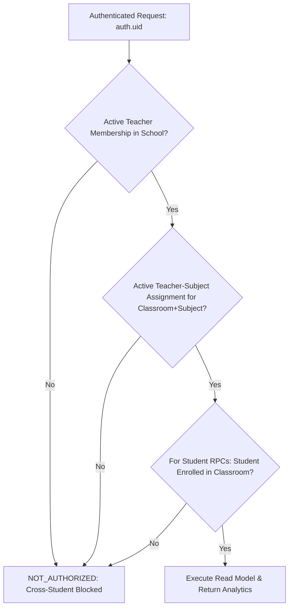

# FidelLearn — P7: Teacher Portal Architecture

## 1. Overview & Vision
The **Teacher Portal** (Priority 7) is FidelLearn's first production-ready institutional experience for educators within secondary schools. It operates on top of the frozen multi-tenant foundation:

```text
P0: Grade 12 Curriculum & Content Architecture (FROZEN)
P2: Adaptive Learning & Personalized Study Planner (FROZEN)
P3: Advanced Scientific Rendering (FROZEN)
P4: Mastery Engine & Intelligent Spaced Repetition (FROZEN)
P5: National Exam Simulation & ESSLCE Mode (FROZEN)
P6 Stage 1: Multi-Tenant Database, RLS & Tenant Security (FROZEN)
P6 Stage 2: Institutional Client Architecture & ActiveSchoolContext (FROZEN)
P7: Teacher Portal (COMPLETED)
```

The core product principle governing P7 is:
> **Students use FidelLearn.**  
> **Teachers act on FidelLearn.**  
> **Schools make decisions with FidelLearn.**

The Teacher Portal is designed to enable teachers to rapidly answer:
1. *Which students need my help?*
2. *Why do they need help?*
3. *Which topic or skill is causing the problem?*
4. *How urgent is it?*
5. *What should I assign or recommend next?*

---

## 2. Multi-Level Authorization & Tenant Scoping
Authorization is strictly enforced server-side via PostgreSQL `SECURITY DEFINER` read-model RPCs. Neither UI nor client code is trusted as an authoritative gatekeeper:



### Authorization Levels
1. **School Level**: `school_memberships.role = 'teacher'` AND `status = 'active'` for `auth.uid()`.
2. **Classroom + Subject Level**: `teacher_subject_assignments.teacher_user_id = auth.uid()` AND `classroom_id = p_classroom_id` AND `subject_id = p_subject_id` AND `status = 'active'`.
3. **Student Level**: `classroom_memberships.user_id = p_student_id` AND `classroom_id = p_classroom_id` AND `status = 'active'`.

Cross-school access, cross-class access, cross-subject access, and student discovery outside assigned classrooms are strictly rejected.

---

## 3. Server-Side Read Models & RPCs
All teacher-facing data is served through 7 purpose-built `SECURITY DEFINER` functions in migration `20260925010000_p7_teacher_portal.sql`:

| RPC Function | Parameters | Authorization Check | Purpose |
|---|---|---|---|
| `resolve_teacher_class_subject_school` | `p_classroom_id`, `p_subject_id` | Verifies active teacher membership & assignment | Resolves tenant `school_id` |
| `get_teacher_assigned_classes` | `p_school_id` | Active teacher membership in `p_school_id` | Class list with enrollment & KPI chips |
| `get_teacher_class_roster` | `p_classroom_id`, `p_subject_id`, `p_limit`, `p_offset`, `p_search` | Assignment check | Paginated roster (25/page) with name/ID search |
| `get_teacher_class_weak_topics` | `p_classroom_id`, `p_subject_id`, `p_limit` | Assignment check | Top weak topics from cloud `mistake_records` |
| `get_teacher_class_exam_summary` | `p_classroom_id`, `p_subject_id`, `p_limit` | Assignment check | Recent assessments preserving P5 `exam_type` |
| `get_teacher_attention_students` | `p_classroom_id`, `p_subject_id`, `p_limit`, `p_offset` | Assignment check | Prioritized intervention list with reason codes |
| `get_teacher_student_summary` | `p_student_id`, `p_classroom_id`, `p_subject_id` | Assignment & student enrollment check | Student academic summary with evidence |

---

## 4. Academic Data Honesty & Provenance

### Cloud Synced vs. Device-Local Realities
FidelLearn adheres strictly to data authenticity and never fabricates metrics:

| Metric | Source | Availability | Teacher Portal Policy |
|---|---|---|---|
| **Practice & Exam Attempts** | Cloud synced (`submitAttempt`) | Available | Fully displayed (counts, score %, completion date) |
| **Mistake Records** | Cloud synced (`recordMistake`) | Available | Fully displayed (active vs mastered, weak topics) |
| **P5 Exam Provenance** | Cloud synced (`exam_type`) | Available | Official labels preserved (`mock_full`, `unit_test`, etc.) |
| **P4 Spaced Repetition Mastery** | Device-local Drift SQLite | Local Only | **Honestly disclosed as device-local**; never faked |
| **National Exam Readiness Score** | Device-local calculation | Local Only | **Honestly disclosed as device-local**; never faked |
| **Study Plans & Goals** | Device-local Drift SQLite | Local Only | Not exposed in cloud portal |

A transparent notice is presented on every student summary and class detail screen:
> *"Spaced-repetition mastery (P4) and exam readiness calculations are device-local to the student's phone and are not yet cloud-synced. Displayed metrics reflect cloud-synced attempts and mistake records only."*

---

## 5. Explainable Attention Engine
The attention system identifies students requiring teacher intervention without black-box ML or subjective ranking.

### Centralized Severity Thresholds
- **Immediate Support (`high`)**: Recent 30-day accuracy $< 50\%$ OR active unmastered mistakes $\ge 5$.
- **Needs Attention (`medium`)**: Recent 30-day accuracy $< 70\%$ OR active unmastered mistakes $\ge 3$ OR no practice in last 14 days.
- **Monitor (`low`)**: Active unmastered mistakes $\ge 1$ OR no practice in last 7 days.

### Machine-Readable Reason Codes & Explanations
1. `low_recent_accuracy`: *"{pct}% average accuracy on recent practice (last 30 days)."*
2. `high_mistake_count`: *"{n} active unmastered mistakes recorded."*
3. `elevated_mistake_count`: *"{n} active mistakes. Review of these topics is overdue."*
4. `no_recent_activity`: *"No practice activity in the last {days} days."*
5. `borderline_accuracy`: *"Accuracy is borderline — additional practice may improve retention."*

### Actionable Next Steps
Every flagged student has a derived next step:
- High mistake count: *"Review mistake notebook together — multiple topics need attention."*
- Low accuracy: *"Assign focused 15-question practice on weak topics."*
- Inactive: *"Check in with student — no recent practice recorded."*

---

## 6. Client Architecture & UI Hierarchy

```text
/teacher
│
├── TeacherHomeScreen
│   ├── School Context Header & Switcher
│   ├── KPI Stats Grid (Total Students, Flagged Items, Active Classes)
│   ├── Offline Banner (when using cached school context)
│   └── Assigned Class Cards
│
├── TeacherClassDetailScreen (/teacher/class/:classroomId/:subjectId)
│   ├── Class KPI Stats
│   ├── Quick Action Buttons ("View Roster", "Needs Attention")
│   ├── Weak Topics Section (cloud mistake records)
│   └── Recent Assessments Section (P5 provenance)
│
├── TeacherClassRosterScreen (/teacher/class/:classroomId/:subjectId/roster)
│   ├── Search Bar (name / student ID filter)
│   ├── Paginated Student List (25/page with Load More)
│   └── Student Cards (accuracy, mistakes, last activity)
│
├── TeacherAttentionScreen (/teacher/class/:classroomId/:subjectId/attention)
│   ├── Severity Filter Chips (All, Immediate Support, Needs Attention, Monitor)
│   ├── Explainable Reason Lists
│   └── Direct Link to Student Summary
│
└── TeacherStudentSummaryScreen (/teacher/class/:classroomId/:subjectId/student/:studentId)
    ├── Student Header & ID
    ├── Recommended Intervention Banner & Assignment Hook
    ├── Academic Metrics Grid (30-day avg, active mistakes, overall accuracy)
    ├── Weak Topics Detail
    ├── Recent Assessment History
    └── Data Provenance & Local-Only Mastery Notice
```

---

## 7. Privacy & Security Safeguards
1. **No Student Phone Numbers**: Only student display name and institutional `school_student_id` are displayed.
2. **No Credentials or Tokens**: Passwords, hashes, and session tokens are strictly excluded from all RPCs.
3. **No Economic Data**: Study Coins, airtime purchases, and ledger transactions are student-private and inaccessible to teachers.
4. **No Unencrypted Sensitive Cache**: Roster data and student performance are never written to permanent disk cache on the teacher's phone.

---

## 8. Verification & Test Suite
- **10 Unit Tests** (`test/unit/teacher_portal_models_and_repo_test.dart`): Domain models, severity parsing, reason generation, mock repository contracts.
- **4 Provider Tests** (`test/unit/teacher_portal_providers_test.dart`): Riverpod state notifiers, search filtering, pagination, and auth guard behavior.
- **5 Widget Tests** (`test/widget/teacher_portal_screens_test.dart`): Full UI rendering of Home, Detail, Roster, Attention, and Student Summary screens.
- **Clean Analysis**: `flutter analyze` returns 0 issues.
- **Zero Formatting Violations**: `dart format` is fully verified.
