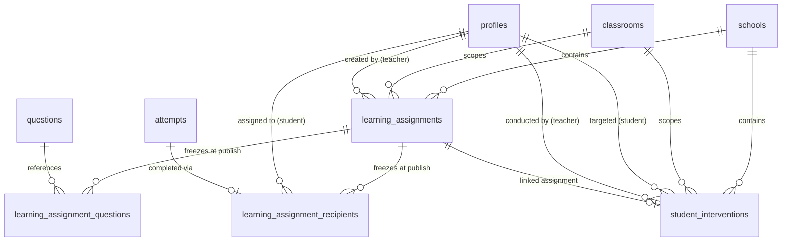
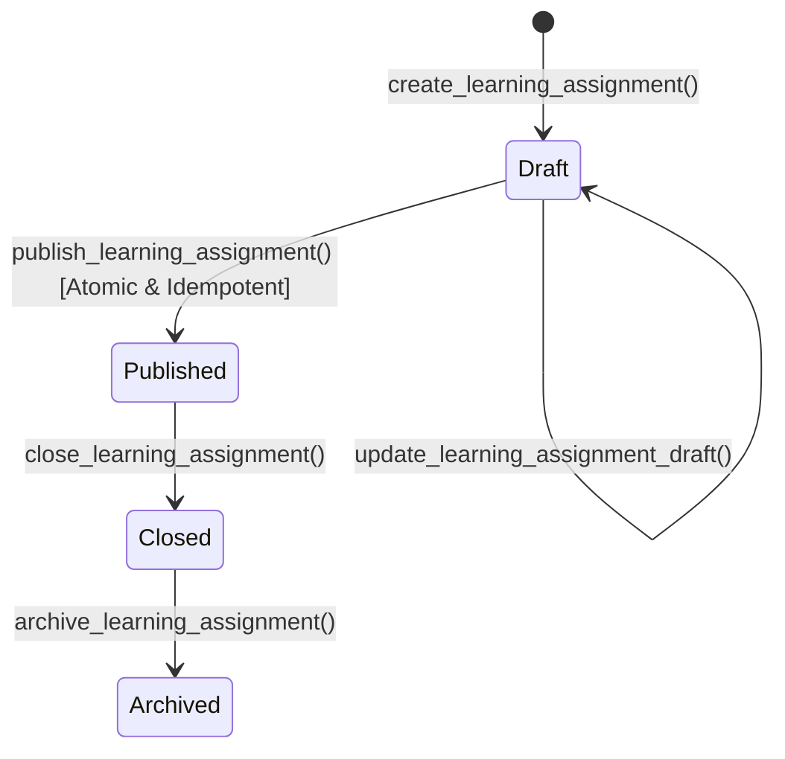

# FidelLearn P9: Assignments + Intervention System Architecture Specification

## 1. Executive Summary & Vision

The **FidelLearn Assignments + Intervention System (P9)** establishes a safe, measurable, and auditable bridge between teacher insights and targeted student action. 

Building upon the multi-tenant institutional foundation (P6), Teacher Portal (P7), and School Leadership (P8), P9 addresses the central product question:
> *"I know this student needs help. What should I assign? How do I assign it? Did the student receive it? Did the student complete it? What happened afterward? Do I need to intervene again?"*

The system adheres strictly to the core FidelLearn invariants:
1. **Teacher-controlled**: No automated punitive actions, no AI-generated student assignments, and no unapproved student targeting.
2. **Offline-first**: Complete offline student execution, pre-flight package asset verification, resilient local persistence, and background cloud sync.
3. **Tenant & Subject Isolation**: Zero cross-school leakage, exact subject/variant verification (including strict Mathematics Natural vs. Social Science variant segregation with zero stream fallback), and classroom membership verification.
4. **Frozen Engine Reuse**: Strict reuse of the P5 National Exam Simulation / Practice Runner, scoring engine, mistake notebook pipeline, and P4 spaced repetition engine (`fidel_spaced_v1.0`).

---

## 2. Domain & Database Architecture

### 2.1 Entity Relationship Diagram



### 2.2 PostgreSQL Cloud Schema

#### Table: `public.learning_assignments`
Stores the metadata, scope, and configuration for teacher assignments.
- `id` (UUID, PK): Unique assignment identifier.
- `school_id` (UUID, NOT NULL): Multi-tenant school scope.
- `classroom_id` (UUID, NOT NULL): Scoped classroom.
- `teacher_user_id` (UUID, NOT NULL): Authoring teacher.
- `subject_id` (TEXT, NOT NULL): Canonical subject identifier (e.g., `math_g12`, `physics_g12`).
- `exam_variant` (TEXT, NULL): Exact exam variant (`naturalScience`, `socialScience`).
- `title` (TEXT, NOT NULL): Assignment title.
- `instructions` (TEXT, NULL): Teacher guidance notes for students.
- `assignment_type` (TEXT, NOT NULL): One of `targetedPractice`, `customQuestionSet`, `simulation`.
- `status` (TEXT, NOT NULL): One of `draft`, `published`, `closed`, `archived`.
- `due_at` (TIMESTAMPTZ, NULL): Deadline for submission.
- `allow_late_submission` (BOOLEAN, NOT NULL DEFAULT true): Policy for submissions after `due_at`.
- `time_limit_minutes` (INT, NOT NULL DEFAULT 0): 0 for untimed, positive integer for timed assessment.
- `total_questions` (INT, NOT NULL DEFAULT 0): Question count frozen at publication.
- `content_hash` (TEXT, NULL): SHA-256 integrity hash of ordered question set, content versions, and packages.
- `created_at` (TIMESTAMPTZ, NOT NULL DEFAULT NOW())
- `updated_at` (TIMESTAMPTZ, NOT NULL DEFAULT NOW())
- `published_at` (TIMESTAMPTZ, NULL)
- `closed_at` (TIMESTAMPTZ, NULL)

#### Table: `public.learning_assignment_questions`
Immutable question snapshot frozen atomically upon publication.
- `assignment_id` (UUID, NOT NULL, FK `learning_assignments.id` ON DELETE CASCADE)
- `question_id` (UUID, NOT NULL, FK `questions.id` ON DELETE RESTRICT)
- `position` (INT, NOT NULL): Zero-based sequential display order.
- `question_content_version` (INT, NOT NULL DEFAULT 1)
- `package_version` (TEXT, NOT NULL DEFAULT '1.0.0')
- `created_at` (TIMESTAMPTZ, NOT NULL DEFAULT NOW())
- Primary Key: `(assignment_id, question_id)`
- Unique Key: `(assignment_id, position)`

#### Table: `public.learning_assignment_recipients`
Explicit recipient snapshot frozen at publication.
- `id` (UUID, PK): Unique recipient record ID.
- `assignment_id` (UUID, NOT NULL, FK `learning_assignments.id` ON DELETE CASCADE)
- `student_user_id` (UUID, NOT NULL, FK `profiles.id` ON DELETE CASCADE)
- `assigned_at` (TIMESTAMPTZ, NOT NULL DEFAULT NOW())
- `status` (TEXT, NOT NULL DEFAULT 'assigned'): One of `assigned`, `inProgress`, `submitted`, `completed`, `late`, `excused`.
- `attempt_id` (UUID, NULL, FK `attempts.id` ON DELETE SET NULL): Scored exam attempt.
- `started_at` (TIMESTAMPTZ, NULL)
- `submitted_at` (TIMESTAMPTZ, NULL)
- `score` (INT, NULL)
- `percentage` (NUMERIC(5,2), NULL)
- `created_at` (TIMESTAMPTZ, NOT NULL DEFAULT NOW())
- `updated_at` (TIMESTAMPTZ, NOT NULL DEFAULT NOW())
- Unique Key: `(assignment_id, student_user_id)`

#### Table: `public.student_interventions`
Tracks formal teacher academic interventions linked to P7 Attention signals or teacher observations.
- `id` (UUID, PK): Unique intervention identifier.
- `school_id` (UUID, NOT NULL, FK `schools.id`)
- `classroom_id` (UUID, NOT NULL, FK `classrooms.id`)
- `subject_id` (TEXT, NOT NULL)
- `exam_variant` (TEXT, NULL)
- `student_user_id` (UUID, NOT NULL, FK `profiles.id`)
- `teacher_user_id` (UUID, NOT NULL, FK `profiles.id`)
- `source` (TEXT, NOT NULL): One of `p7Attention`, `teacherObservation`, `assessmentReview`, `mistakeReview`.
- `source_reason_codes` (JSONB, NOT NULL DEFAULT '[]'): Snapshot of P7 attention reason codes (e.g., `["lowRecentAccuracy", "highMistakeCount"]`).
- `severity_at_creation` (TEXT, NULL): Snapshot of severity (`high`, `medium`, `low`).
- `action_type` (TEXT, NOT NULL): One of `targetedPractice`, `reviewMistakes`, `simulation`, `teacherFollowUp`.
- `linked_assignment_id` (UUID, NULL, FK `learning_assignments.id` ON DELETE SET NULL)
- `status` (TEXT, NOT NULL DEFAULT 'open'): One of `open`, `active`, `completed`, `closed`.
- `teacher_note` (TEXT, NULL): Bounded academic notes (maximum 1,000 characters).
- `created_at` (TIMESTAMPTZ, NOT NULL DEFAULT NOW())
- `updated_at` (TIMESTAMPTZ, NOT NULL DEFAULT NOW())
- `started_at` (TIMESTAMPTZ, NULL)
- `completed_at` (TIMESTAMPTZ, NULL)
- `closed_at` (TIMESTAMPTZ, NULL)

---

## 3. Authorization & Security Model

All assignment and intervention mutations execute via `SECURITY DEFINER` functions with search path set to `public, pg_temp`. The client's JWT claim (`auth.uid()`) is authoritative; client-supplied teacher UUIDs are never trusted.

### 3.1 Teacher Authorization Gates
A teacher may create, edit, publish, close, or archive an assignment, or initiate an intervention, if and only if:
1. `caller_id = auth.uid()`.
2. Caller has an active `teacher` role in `school_memberships` for `school_id`.
3. School status is `'active'` (suspended or revoked schools are rejected).
4. An active entry exists in `teacher_subject_assignments` matching:
   - `school_id = target_school_id`
   - `classroom_id = target_classroom_id`
   - `teacher_user_id = auth.uid()`
   - `subject_id = target_subject_id`
   - `exam_variant IS NOT DISTINCT FROM target_exam_variant` (or covers the target variant).

### 3.2 Student Recipient Gates
- At publication time, recipient students must possess active `student` membership in `school_memberships` for `school_id` AND active membership in `classroom_memberships` for `classroom_id`.
- Unenrolled or cross-school students cannot be added to assignments.
- Students can **only query** assignment records where `learning_assignment_recipients.student_user_id = auth.uid()`.
- Students have **zero mutation rights** on assignments, recipients, or interventions.
- Direct INSERT/UPDATE permissions on all assignment tables are REVOKED from `anon` and `authenticated`.

### 3.3 School Admin Oversight
- School Admins possess read-only oversight for assignments, recipient progress, and interventions within their own active school tenant via `resolve_school_admin_authority`.
- School Admins cannot edit teacher assignments or alter student submissions.

---

## 4. Assignment Lifecycle & Immutability



### 4.1 State Semantics
- **`draft`**: Editable by the authoring teacher. Questions and recipient rosters can be modified. Completely invisible to students.
- **`published`**: Content and recipient rosters are **strictly frozen**. Students can see the assignment in their inbox and take it offline. Once published, questions, positions, and recipient snapshots **never dynamically change**.
- **`closed`**: Assignment is finalized. If `allow_late_submission` is false, no new starts or submissions are accepted. If true, late submissions are accepted and flagged.
- **`archived`**: Retained as an institutional historical audit record.

### 4.2 Publication Transaction & Idempotency
Publishing an assignment is an atomic server transaction executing:
1. Verify teacher authority for `(school_id, classroom_id, subject_id, exam_variant)`.
2. Ensure assignment is in `'draft'` status.
3. Validate question pool sufficiency and verification status (all questions must be verified/approved static content).
4. Check exact Mathematics variant isolation (if `math_g12`, natural science assignments contain 0 social science questions, 0 null/shared questions).
5. Freeze `learning_assignment_questions` with explicit position numbers and versions.
6. Calculate assignment SHA-256 fingerprint:
   $$\text{Hash} = \text{SHA256}(\text{assignmentId} \parallel \text{subjectId} \parallel \text{variant} \parallel q_1, q_2, \dots \parallel v_1, v_2, \dots)$$
7. Resolve active classroom roster (or explicit student subset) and insert into `learning_assignment_recipients`.
8. Transition status to `'published'` with `published_at = NOW()`.
9. Insert audit log event `assignment_published`.

If the publish function is called a second time with the same assignment ID, it operates idempotently, returning success without re-creating recipient rows or duplicate audit logs.

---

## 5. Recipient Snapshot & Roster Dynamics

### 5.1 New Student Joins After Publication
When a new student joins a classroom after an assignment is published:
- The student is **not automatically backfilled** into the assignment.
- This preserves the original denominator ($N_{\text{assigned}}$) and statistical integrity.
- If the teacher explicitly chooses to add the student later, a dedicated `add_assignment_recipient` RPC is executed, logging an `assignment_recipient_added` audit event.

### 5.2 Student Leaves Classroom After Publication
- Historical recipient records are **never deleted**.
- Denominators are preserved for historical audit.
- Unstarted work is marked excused or left as historical non-attempt.

---

## 6. Offline Execution & Asset Pre-Flight

### 6.1 Pre-Flight Offline Readiness Check
Before a student initiates an assignment offline, the local device verifies:
1. Subject `.flpkg` package is downloaded and verified.
2. All assigned question IDs exist in local SQLite question storage.
3. Required SVG diagrams, LaTeX scientific rendering resources, and stimulus reading passages are locally cached.

Visual indicators on the Student Assignment Card:
- 🟢 **Ready Offline**: All assets present.
- 🟡 **Download Required**: Assignment metadata synced, but subject package asset download pending.
- 🔴 **Unavailable**: Content package missing or corrupted.

### 6.2 Offline Attempt Flow & Runner Integration
Assignments execute through the **existing P5 Exam Runner** (`ExamRunnerScreen`):
1. The student opens the assignment detail and clicks **"Start Assignment"**.
2. An `Exam` entity is constructed with:
   - `id = 'assignment_' + assignment.id`
   - `title = assignment.title`
   - `examType = ExamType.teacherAssigned` (contextual)
   - `examMode = ExamMode.practice` (or `nationalSimulation`)
   - `sourceType = ExamSourceType.generatedSimulation` (or historical)
   - `questions = assignmentQuestions` (exact frozen sequence)
   - `timeLimitMinutes = assignment.timeLimitMinutes`
3. The runner runs locally with instant feedback suppressed for timed assessments, or enabled for targeted practice.
4. Responses auto-save to `DbActiveAttempts`.
5. Upon completion, `ExamSubmissionService.finalizeSubmission()`:
   - Records completed `ExamAttempt` in Drift `DbExamAttempts`.
   - Idempotently processes question outcomes via `MistakeOutcomeService` (updating mistake notebook and local P4 mastery).
   - Idempotently awards Study Coins with unique attempt key (`exam_<attempt_id>`).
   - Updates local assignment recipient state to `'submitted'` or `'completed'`.
   - Enqueues cloud sync operation `submitAssignment` in `DbSyncQueue`.

### 6.3 Deadline Semantics (Offline Edge Case)
- **Local Completion Timestamp**: The student finishes the exam offline at $T_{\text{local}}$.
- **Server Receipt Timestamp**: The device reconnects to Wi-Fi at $T_{\text{sync}}$.
- If $T_{\text{local}} \le \text{due\_at}$, the submission is **on-time**, even if $T_{\text{sync}} > \text{due\_at}$.
- The trusted local attempt completion timestamp is cryptographically bound to the attempt snapshot and honored during cloud reconciliation.

---

## 7. Intervention System & P7 Integration

### 7.1 Intervention Workflow

```text
P7 Needs Attention Signal (e.g. lowRecentAccuracy, highMistakeCount)
         ↓
Teacher clicks "Create Intervention" or "Assign Targeted Practice"
         ↓
P9 Intervention Modal / Form (prefilled with student, subject, reason codes, severity)
         ↓
Teacher selects Action Type (targetedPractice, reviewMistakes, simulation, teacherFollowUp)
         ↓ (optional)
Teacher links / creates targeted assignment
         ↓
Student executes assigned work (online or offline)
         ↓
Outcomes synchronize to cloud
         ↓
Teacher reviews follow-up evidence in Intervention Center
         ↓
Intervention marked 'completed' or 'closed'
```

### 7.2 Non-Equivalence Contract
> **CRITICAL ARCHITECTURAL RULE:**  
> $\text{Intervention Completed} \ne \text{Academically Resolved}$
- Marking an intervention **`completed`** certifies that the **prescribed action was executed**.
- It does **not** assert that the student's underlying conceptual misconception has vanished.
- Follow-up evidence (subsequent practice accuracy, active mistake count reduction) is displayed as separate, empirical observational metrics.

---

## 8. Drift SQLite Storage & Migration (v8 $\rightarrow$ v9)

To ensure student assignments and recipient states remain resiliently queryable in the Student Assignment Inbox offline without polluting `SharedPreferences` or overloading `DbStudyPlans`, Drift is migrated from **schema version 8 to version 9**.

### 8.1 Drift Tables Added in v9
1. **`DbLearningAssignments`**:
   - `id` (TextColumn, PK)
   - `schoolId` (TextColumn)
   - `classroomId` (TextColumn)
   - `teacherUserId` (TextColumn)
   - `subjectId` (TextColumn)
   - `examVariant` (TextColumn, nullable)
   - `title` (TextColumn)
   - `instructions` (TextColumn, nullable)
   - `assignmentType` (TextColumn)
   - `status` (TextColumn)
   - `dueAt` (DateTimeColumn, nullable)
   - `allowLateSubmission` (BoolColumn)
   - `timeLimitMinutes` (IntColumn)
   - `totalQuestions` (IntColumn)
   - `contentHash` (TextColumn, nullable)
   - `questionIdsJson` (TextColumn)
   - `publishedAt` (DateTimeColumn, nullable)
   - `syncedAt` (DateTimeColumn)

2. **`DbAssignmentRecipients`**:
   - `id` (TextColumn, PK)
   - `assignmentId` (TextColumn)
   - `studentUserId` (TextColumn)
   - `assignedAt` (DateTimeColumn)
   - `status` (TextColumn)
   - `attemptId` (TextColumn, nullable)
   - `startedAt` (DateTimeColumn, nullable)
   - `submittedAt` (DateTimeColumn, nullable)
   - `score` (IntColumn, nullable)
   - `percentage` (RealColumn, nullable)
   - `syncStatus` (TextColumn): `'synced'` | `'pending'`

### 8.2 Safe Migration Guarantee
The `onUpgrade` hook executes `safeCreateTable(dbLearningAssignments)` and `safeCreateTable(dbAssignmentRecipients)`. All existing tables (`dbExamAttempts`, `dbMistakes`, `dbQuestionMastery`, `dbCoinLedger`, `dbStudyPlans`) remain strictly untouched.

---

## 9. Audit Logging & Verification

Every institutional mutation generates an audit record in `public.audit_log`:
- `assignment_created`
- `assignment_published`
- `assignment_closed`
- `assignment_archived`
- `assignment_recipient_added`
- `intervention_created`
- `intervention_updated`
- `intervention_completed`
- `intervention_closed`

Full question stems and student answer choices are **never logged** in audit logs to protect student privacy and minimize log bloat.
