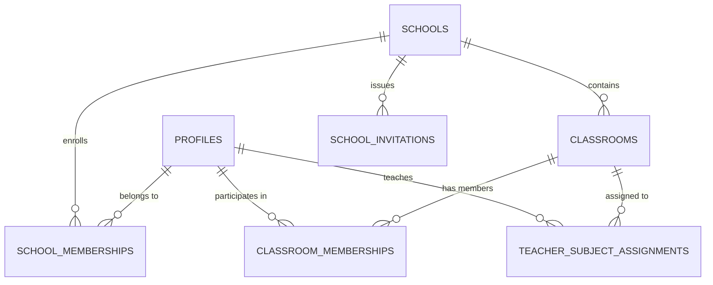

# FidelLearn — Multi-Tenant School & Tenant Architecture Specification (`P6 Stage 1`)

## 1. Executive Overview & Core Architectural Principle

FidelLearn is an offline-first Ethiopian national-exam preparation and institutional learning platform.
Following the completion and freeze of the core student-learning foundation (**P0–P5**), the product transitions into its institutional SaaS phase:

> **Students use FidelLearn.**  
> **Teachers act on FidelLearn.**  
> **School leaders make decisions with FidelLearn.**

The foundational security requirement of P6 Stage 1 is:

> **A user can belong to a school, classroom, and institutional role, while PostgreSQL itself guarantees that the user cannot cross the tenant boundary or promote their own authority.**  
> **Tenant authority comes from verified school membership and backend RLS—not from a global role, local cache, route, button, or client-provided school ID.**

---

## 2. Global vs. Tenant-Scoped Roles

Prior to P6, FidelLearn used a global role model (`student`, `teacher`, `school_admin`, `platform_admin`) attached to user profiles. This created a critical architectural risk: a user with `teacher` or `school_admin` held no school boundary, implying authority across any school.

P6 enforces a strict separation:

```text
User Account (Auth / Profile)
│
├── Global Platform Authority
│     └── platform_admin (System management, tenant onboarding, curriculum publishing)
│
└── Institutional Authority (Tenant-Scoped via SchoolMembership)
      ├── School A (ID: 1111...)
      │     └── Role: teacher (Active)
      └── School B (ID: 2222...)
            └── Role: teacher (Active)
```

### Global Role Deprecation Strategy
- `UserRole.student`: Global default identity for every user upon registration.
- `UserRole.platformAdmin`: Global system administrator managed by Edge Functions.
- `UserRole.teacher` & `UserRole.schoolAdmin`: **Formally deprecated as global claims.**
  - Existing database rows in `public.user_roles` with `role_id IN ('teacher', 'school_admin')` confer **ZERO tenant data authority**.
  - All Supabase RLS policies and RPCs query `public.school_memberships`, checking `status = 'active'`, completely ignoring legacy global claims.
  - Client-side code annotates `UserRole.teacher` and `UserRole.schoolAdmin` as deprecated.

---

## 3. Core Database Schema & Entities

The multi-tenant architecture is implemented in PostgreSQL migration `20260925000000_school_tenant_security.sql`.



### 3.1 `schools`
Represents an educational tenant (e.g. secondary school).
- `id` (UUID, PK)
- `name` (TEXT, NOT NULL)
- `display_name` (TEXT)
- `school_code` (TEXT, NOT NULL, UNIQUE, e.g. `FID-BOL001`)
- `status` (TEXT, NOT NULL, CHECK `active`, `suspended`, `archived`)
- `city`, `region`, `timezone` (Default: `Africa/Addis_Ababa`), `logo_url`
- `created_by` (UUID, FK -> `profiles.id`)
- `created_at`, `updated_at` (TIMESTAMPTZ)

### 3.2 `school_memberships`
Defines institutional affiliation and tenant-scoped role.
- `id` (UUID, PK)
- `school_id` (UUID, NOT NULL, FK -> `schools.id` ON DELETE RESTRICT)
- `user_id` (UUID, NOT NULL, FK -> `profiles.id` ON DELETE CASCADE)
- `role` (TEXT, NOT NULL, CHECK `student`, `teacher`, `school_admin`)
- `status` (TEXT, NOT NULL, CHECK `invited`, `active`, `inactive`, `removed`)
- `school_student_id` (TEXT, optional school-issued ID)
- `joined_at`, `created_at`, `updated_at` (TIMESTAMPTZ)
- **Constraint**: `UNIQUE (school_id, user_id)` (One canonical membership record per school + user. Role can evolve over time without creating duplicate memberships).

### 3.3 `classrooms`
Represents an academic cohort within a specific school and academic year.
- `id` (UUID, PK)
- `school_id` (UUID, NOT NULL, FK -> `schools.id` ON DELETE RESTRICT)
- `name` (TEXT, NOT NULL, e.g. `Grade 12 Natural - Section A`)
- `grade` (INT, CHECK 6, 7, 8, 9, 10, 11, 12)
- `stream` (TEXT, CHECK `naturalScience`, `socialScience`, `common`)
- `section` (TEXT, e.g. `A`, `B`)
- `academic_year` (TEXT, NOT NULL, e.g. `2026/27`)
- `status` (TEXT, CHECK `active`, `archived`)
- `created_at`, `updated_at` (TIMESTAMPTZ)

### 3.4 `classroom_memberships`
Links students and teachers to a specific classroom cohort.
- `id` (UUID, PK)
- `classroom_id` (UUID, NOT NULL, FK -> `classrooms.id` ON DELETE CASCADE)
- `user_id` (UUID, NOT NULL, FK -> `profiles.id` ON DELETE CASCADE)
- `role` (TEXT, NOT NULL, CHECK `student`, `teacher`)
- `status` (TEXT, NOT NULL, CHECK `active`, `inactive`, `removed`)
- **Invariant**: The member MUST have an active membership in the classroom's parent school. Enforced server-side in `assign_classroom_member_internal`.
- **Constraint**: `UNIQUE (classroom_id, user_id)`.

### 3.5 `teacher_subject_assignments`
Granular mapping of teacher responsibilities to specific subjects and assessment variants.
- `id` (UUID, PK)
- `school_id` (UUID, NOT NULL, FK -> `schools.id` ON DELETE RESTRICT)
- `teacher_user_id` (UUID, NOT NULL, FK -> `profiles.id` ON DELETE CASCADE)
- `classroom_id` (UUID, NOT NULL, FK -> `classrooms.id` ON DELETE CASCADE)
- `subject_id` (TEXT, NOT NULL, FK -> `subjects.id` ON DELETE RESTRICT)
- `exam_variant` (TEXT, NULLABLE, CHECK `naturalScience`, `socialScience`, `shared`)
- `status` (TEXT, NOT NULL, CHECK `active`, `inactive`, `archived`)
- **Invariant**: Teacher must have an active `teacher` membership in `school_id`, and classroom must belong to `school_id`. Enforced in `assign_teacher_subject_internal`.

### 3.6 `school_invitations`
Token-based invitation for onboarding students, teachers, and school administrators without pre-registering passwords.
- `id` (UUID, PK)
- `school_id` (UUID, NOT NULL, FK -> `schools.id` ON DELETE CASCADE)
- `role` (TEXT, NOT NULL, CHECK `student`, `teacher`, `school_admin`)
- `email_or_identifier` (TEXT, NULLABLE)
- `token_hash` (TEXT, NOT NULL, UNIQUE — cryptographic hash, never plaintext)
- `expires_at` (TIMESTAMPTZ, NOT NULL)
- `status` (TEXT, CHECK `pending`, `redeemed`, `expired`, `revoked`)

---

## 4. Authoritative PostgreSQL Security Functions

All security functions are implemented as `STABLE SECURITY DEFINER` with explicit `search_path = public, pg_temp` and derive caller identity strictly from `auth.uid()`.

```sql
-- Checks if caller has global platform admin privileges
public.is_platform_admin() RETURNS BOOLEAN;

-- Checks if caller is an active member of the specified active school
public.is_school_member(target_school_id UUID) RETURNS BOOLEAN;

-- Checks if caller is an active school administrator of the specified active school
public.is_school_admin(target_school_id UUID) RETURNS BOOLEAN;

-- Checks if caller is an active teacher in the specified active school
public.is_teacher_in_school(target_school_id UUID) RETURNS BOOLEAN;

-- Evaluates student academic data access authority
public.can_access_student(target_student_id UUID, target_school_id UUID) RETURNS BOOLEAN;
```

### The Student Access Rule (`can_access_student`)
Student data access is granted **only** under the following verified conditions:
1. **Self**: The caller is the student (`auth.uid() = target_student_id`).
2. **Platform Admin**: Caller possesses verified `platform_admin` global role.
3. **School Admin**: Caller has active `school_admin` membership in `target_school_id`, AND target student has active membership in `target_school_id`.
4. **Teacher**: Caller has active `teacher` membership in `target_school_id`, AND target student has active membership in `target_school_id`, **AND the teacher is actively assigned to a classroom that contains the student** (`teacher_subject_assignments` -> `classroom_memberships`).
5. **Otherwise: DENIED.** (Unassigned teachers in the same school CANNOT access the student!).

---

## 5. Row Level Security (RLS) Policy Matrix

| Table | SELECT Policy | INSERT Policy | UPDATE Policy | DELETE Policy |
|---|---|---|---|---|
| `schools` | Active member of school OR Platform Admin | Blocked (RPC only) | School Admin of school OR Platform Admin | Blocked (Status lifecycle only) |
| `school_memberships` | Own record OR School Admin of school OR Platform Admin OR Assigned Teacher for students in class | Blocked (RPC only) | Blocked (RPC only) | Blocked (Status lifecycle only) |
| `classrooms` | Enrolled active student OR Assigned active teacher OR School Admin of school OR Platform Admin | Blocked (RPC only) | School Admin of school OR Platform Admin | Blocked (Status lifecycle only) |
| `classroom_memberships` | Own enrollment OR Assigned teacher for class OR School Admin of school OR Platform Admin | Blocked (RPC only) | Blocked (RPC only) | Blocked (Status lifecycle only) |
| `teacher_subject_assignments` | The assigned teacher herself OR School Admin of school OR Platform Admin | Blocked (RPC only) | Blocked (RPC only) | Blocked (RPC only) |
| `school_invitations` | School Admin of school OR Platform Admin | Blocked (RPC only) | School Admin of school OR Platform Admin | Blocked |

---

## 6. Privileged Server-Side Mutation RPCs

To guarantee atomicity, cross-tenant referential integrity, and immutable audit logging, all administrative mutations must execute via `SECURITY DEFINER` RPCs:

1. **`create_school_internal`**:
   - Authorized: `platform_admin` only.
   - Creates school, generates uppercase normalized `school_code`, records audit log entry.
2. **`grant_school_membership_internal`**:
   - Authorized: `platform_admin` (any school) OR `school_admin` (own school only).
   - Validates role (`student`, `teacher`, `school_admin`).
   - School Admin CANNOT grant `platform_admin`.
   - Upserts membership record (`UNIQUE(school_id, user_id)`), logs to `audit_log`.
3. **`update_school_membership_status_internal`**:
   - Authorized: `platform_admin` OR `school_admin` of the membership's school.
   - Updates status (`active`, `inactive`, `removed`), logs old/new status to `audit_log`.
4. **`create_classroom_internal`**:
   - Authorized: `platform_admin` OR `school_admin` of that school.
   - Enforces grade, stream, and academic year identity, logs to `audit_log`.
5. **`assign_classroom_member_internal`**:
   - Authorized: `platform_admin` OR `school_admin` of the classroom's school.
   - **Cross-tenant guard**: Validates that target user has an active membership in the classroom's school. Rejects foreign tenant members with `check_violation`.
6. **`assign_teacher_subject_internal`**:
   - Authorized: `platform_admin` OR `school_admin` of the school.
   - **Cross-tenant guards**: Validates that classroom belongs to the school AND teacher has an active `teacher` membership in that school. Rejects cross-tenant assignments with `check_violation`.

---

## 7. Audit Logging Architecture

Privileged mutations record immutable audit rows in `public.audit_log`:

```sql
INSERT INTO public.audit_log (actor_id, action, target_table, target_id, metadata)
VALUES (
    auth.uid(),
    'school_membership_created',
    'school_memberships',
    v_membership.id::TEXT,
    jsonb_build_object(
        'school_id', p_school_id,
        'target_user_id', p_user_id,
        'role', p_role,
        'status', 'active'
    )
);
```

- Direct client `INSERT`, `UPDATE`, `DELETE` on `audit_log` is blocked via RLS (`WITH CHECK (FALSE)`).
- Only `platform_admin` may read `audit_log`.
- Logged actions:
  - `school_created`
  - `school_membership_created`
  - `school_membership_role_updated`
  - `school_membership_status_updated`
  - `classroom_created`
  - `classroom_member_assigned`
  - `teacher_subject_assigned`

---

## 8. Student Account Independence & Transfer Behavior

1. **Student Account Ownership**:
   - A student account is owned by the student, not the school tenant.
   - Exam attempts, question responses, Study Coin balances, mistake records, and spaced repetition mastery (`fidel_spaced_v1.0`) are linked directly to `profiles.id` (`auth.uid()`), never to `school_id`.
2. **Independent Students**:
   - A student can exist with 0 school memberships. All standard self-study, offline practice, national exam simulation, and rewards remain 100% accessible.
3. **Student Transfer Lifecycle**:
   - When a student transfers from School A to School B:
     - School A membership is marked `status = 'inactive'` or `'removed'`.
     - School B membership is created with `status = 'active'`.
     - Student profile UUID remains identical.
     - Entire historical learning data is preserved.
     - School A teachers/admins immediately lose read access to the student; School B teachers/admins gain authorized access.
4. **Multi-School Teachers**:
   - A teacher can hold active memberships in multiple schools (e.g. School A and School B).
   - All queries and classroom operations are strictly parameterized and guarded by `school_id`.
   - No data bleeding or cross-tenant query contamination occurs.

---

## 9. Offline Cache vs. Backend Authorization

In FidelLearn's offline-first architecture, local storage (`SharedPreferences`, `AuthSessionStorage`, SQLite) caches session state for smooth UX in low-connectivity environments:

$$\text{Local Storage Cache} \neq \text{Authorization}$$

- A client-side modification of local JSON (`role = "school_admin"`, `schoolId = "..."`) grants **zero** backend authority.
- All Supabase requests re-evaluate RLS policies against PostgreSQL tables and the cryptographically verified JWT (`auth.uid()`).
- In offline mode, the client operates solely on previously synced and cached local data. No privilege escalation is possible.

---

## 10. Institutional Access Matrix

| Action | Student | Teacher (Assigned) | Teacher (Unassigned) | School Admin | Platform Admin |
|---|---|---|---|---|---|
| Read own school membership | Yes | Yes | Yes | Yes | Yes |
| Read own classroom cohort | Yes | Yes | No | Yes | Yes |
| Read assigned class roster | No | Yes | No | Yes | Yes |
| Read unrelated class roster | No | No | No | Yes (own school) | Yes (all) |
| Access student academic stats | Self only | Yes (assigned students) | No | Yes (own school) | Yes (all) |
| Manage school membership | No | No | No | Yes (own school) | Yes (all) |
| Create / archive classrooms | No | No | No | Yes (own school) | Yes (all) |
| Assign teachers to subjects | No | No | No | Yes (own school) | Yes (all) |
| Create new school tenant | No | No | No | No | Yes |
| Grant platform admin | No | No | No | No | Edge Function only |

---

## 11. Scale & Performance Modeling

For a representative institutional secondary school:
- **1,500 students**
- **80 teachers**
- **40 classrooms**

Performance guarantees:
1. Indexed lookups on `school_memberships(school_id, status)` and `school_memberships(user_id, status)` ensure sub-5ms membership validation.
2. Composite index on `teacher_subject_assignments(teacher_user_id, status)` allows instant resolution of a teacher's authorized classrooms.
3. Roster queries support server-side pagination (`LIMIT` / `OFFSET` or cursor-based) to prevent large payload transfers over 2G/3G mobile networks.

---

## 12. P6 Stage 2 — Institutional Client & Application Architecture

### 12.1 Pure Dart Domain Layer
- `School`, `SchoolMembership`, `SchoolMembershipWithSchool`, `Classroom`, `ClassroomMembership`, `TeacherSubjectAssignment`, `SchoolInvitation`.
- Zero external dependencies on Flutter UI, Supabase, Drift, or PostgREST in domain models.
- Reuses canonical `ExamVariantCode` from `subject_models.dart`.
- Normalized Grade 12 stream semantics (`naturalScience`, `socialScience`).
- Classroom architecture updated to remove single `teacherId` assumption.

### 12.2 Repository Contracts & Production Wiring
- `SchoolRepository` $\longrightarrow$ `SupabaseSchoolRepository` (production) / `LocalSchoolRepository` (test only).
- `ClassroomRepository` $\longrightarrow$ `SupabaseClassroomRepository` (production) / `MockClassroomRepository` (test only).
- Direct client mutations blocked by Stage 1 RLS; mutations occur via approved backend RPCs.
- No silent fallback to mock data on network errors.

### 12.3 ActiveSchoolContext
- Application state machine providing display context: `independent`, `active`, `offlineCached`, `permissionRevoked`.
- Offline affiliation caching via `AuthSessionStorage` without caching sensitive rosters.
- Strict security invariant: Local context is display only; PostgreSQL RLS is the sole authoritative gatekeeper.
- Full isolation on sign-out and user switching.
